<h1 align="center">
  <picture>
    <source media="(prefers-color-scheme: dark)" srcset="macos/icons/AppIcon-dark.png">
    
  </picture>
  <br>
  Newelle - Your Ultimate Virtual Assistant
</h1>
<p align="center">
    <a href="https://github.com/topics/newelle-extension">
      <picture>
        <source srcset="https://raw.githubusercontent.com/qwersyk/Assets/main/newelle-extension.svg" media="(prefers-color-scheme: light)">
        <source srcset="https://raw.githubusercontent.com/qwersyk/Assets/main/newelle-extension-dark.svg" media="(prefers-color-scheme: dark)">
        
      </picture>
    </a>
    <a href="https://github.com/qwersyk/Newelle/wiki">
      <picture>
        <source srcset="https://raw.githubusercontent.com/qwersyk/Assets/main/newelle-wiki.svg" media="(prefers-color-scheme: light)">
        <source srcset="https://raw.githubusercontent.com/qwersyk/Assets/main/newelle-wiki-dark.svg" media="(prefers-color-scheme: dark)">
        
      </picture>
    </a>
	<a href="https://newelle.qsk.me/discord">
      <picture>
        <source srcset="https://raw.githubusercontent.com/qwersyk/Assets/main/discord.svg" media="(prefers-color-scheme: light)">
        <source srcset="https://raw.githubusercontent.com/qwersyk/Assets/main/discord-dark.svg" media="(prefers-color-scheme: dark)">
        
      </picture>
    </a>
    <br>
</p>

https://github.com/user-attachments/assets/909edf0e-5a79-40c2-a3ef-cb5b2b18abfc

# Features


- 🎨 **Advanced Customization**: Tailor the application with a wide range of settings
- ✈️ **Connect Newelle to anything**: Interfaces allow you to control Newelle from Telegram, via API or anything else
- 🚀 **Flexible Model Support**: Choose from mutliple AI models and providers to fit your specific needs
- 📚 **Local models**: Download local models directly from Newelle, and run them using Llama.cpp or Ollama.
- 💻 **Terminal Command Exection**: Execute commands suggested by the AI on the fly
- 🧩 **Extensions**: Add your own functionalities and models to Newelle
- ✨ **Skills**: Newelle supports skills from Claude, Codex...
- 🛠 **Tools & MCP support**: Add tools via MCP servers or extensions, supporting tool search
- 🗣 **Voice support**: Chat hands free with Newelle, supporting many Speech To Text and TTS models (With wakeword support)
- 📞 **Call Mode**: Chat in real time with AI models
- 🧠 **Long Term Memory**: Remember conversations from previous chats
- 💼 **Chat with documents**: Chat with your own documents
- 🖼 **Image Generation**: Generate images directly in Newelle with stablediffusion or use third party services
- 🔎 **Web Search**: Provide reliable answers using Web Search
- 🌐 **Website Reading**: Scrape informations from websites by appending the prefix #https://.. in the prompt
- 🖍 **Dynamic Context Management**: Dynamically summarize and remove non relevant messages to fit in the context
- 🔓 **File Permissions**: Set permissions to which files to edit/read
- ⏰ **Scheduled Tasks**: Schedule tasks to run in the background
- 👤 **Profile Manager**: Create settings profiles and switch between them
- 📁 **Builtin File Manager**: Manage you files with the help of AI
- 📝 **Rich Formatting**: Supports both Markdown and LaTeX
- 💬 **Multichat**: Run multiple chats at the same time
- 🌳 **Chat Branching**: Create alternative versions of your chats strating from any message in one click
- ✏️ **Chat editing**: Edit or remove any message and manage your prompts easily
- 🗂 **Chat Folders**: Organize your chats into folders

<picture>
  <source srcset="screenshots/macos.png" media="(prefers-color-scheme: light)">
  <source srcset="screenshots/macos_b.png" media="(prefers-color-scheme: dark)">
  
</picture>

# Installation

Build from source on macOS:

```bash
/usr/bin/env bash macos/build_newelle_dmg.sh
```
